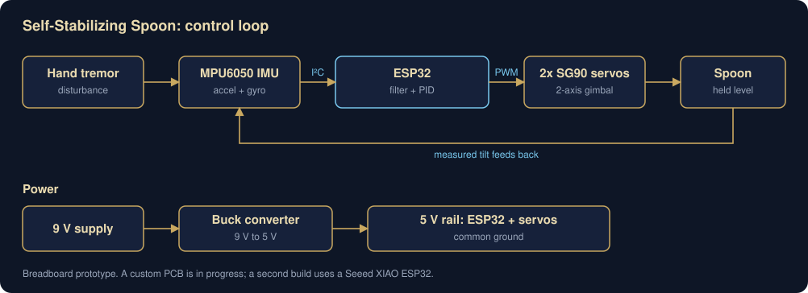

# Self-Stabilizing Spoon

A spoon that cancels hand tremors. An IMU measures how the hand is moving, and a PID loop running on an ESP32 drives two servos in a 2-axis gimbal to keep the spoon level.

**Status:** working breadboard prototype, firmware is up in `firmware/`. A friend and I are designing a custom PCB for it.



## How it works

1. The **MPU6050** reads acceleration and rotation over I²C (400 kHz, with the chip's built-in ~42 Hz low-pass filter on).
2. The **ESP32** combines those readings into a pitch and roll estimate with a complementary filter (98% gyro, 2% accelerometer), so gyro drift and accelerometer noise don't throw it off. The gyro bias gets measured at startup while the board sits still.
3. A **PID loop** on each axis compares the spoon's tilt to level and computes a correction. The loop runs at a fixed 200 Hz.
4. Two **SG90 servos**, mounted in series as a gimbal, move the spoon opposite to the hand's motion.

A couple of things in the PID that fixed problems I actually ran into:

- **Derivative on measurement.** The D term uses the gyro rate directly instead of differentiating the error, which was way too noisy.
- **Anti-windup.** The integral stops growing while the output is maxed out, so it doesn't overshoot after the servo hits its limit.
- **Microsecond servo writes.** `writeMicroseconds()` instead of `write()`, so the servos aren't stuck moving in 1° steps.

## Hardware

| Part | What it does |
|---|---|
| ESP32 (second build: Seeed XIAO ESP32) | Runs the filter and both PID loops |
| MPU6050 IMU | Accelerometer + gyroscope, I²C |
| 2x SG90 servos | Pitch and roll axes of the gimbal |
| Buck converter | Steps a 9 V supply down to 5 V |
| 9 V supply | Powers everything, with a common ground |

### Pins

| Signal | ESP32 pin |
|---|---|
| Roll servo | GPIO 19 |
| Pitch servo | GPIO 18 |
| MPU6050 SDA / SCL | default I²C pins (GPIO 21 / 22 on a standard ESP32 dev board) |

## Running it

1. Install the **ESP32Servo** and **MPU6050** (Electronic Cats / i2cdevlib) libraries in the Arduino IDE.
2. Open `firmware/gimbal_pid/gimbal_pid.ino` and upload it.
3. Keep the board still for the first couple seconds while it calibrates the gyro.
4. To watch the tuning live, close the Serial Monitor and run the plotter:

```
pip install pyserial matplotlib
python tools/pid_plotter.py COM3
```

It plots roll and pitch against the target, shades the error, and shows the current, max, and RMS error over the last 10 seconds.

## What I learned

This is the project where I learned PID and sensor filtering from scratch: how IMUs work, why a raw accelerometer is too noisy to use alone, and the difference between complementary and Kalman filters. It's also where I learned to separate a slow signal from a fast one by frequency, which is the core of telling a hand tremor apart from intentional movement.

## What's next

- [x] Upload the firmware
- [x] Live plotter for tuning
- [ ] Finish the custom PCB and move off the breadboard
- [ ] Full wiring diagram
- [ ] Add photos and a demo video
- [ ] Compare against an Arduino Nano build for more predictable loop timing

## Repo layout

```
firmware/
  gimbal_pid/   current ESP32 code
  archive/      earlier versions, kept to show how it changed
tools/
  pid_plotter.py   live serial plotter for tuning
hardware/     wiring and PCB files (coming soon)
docs/         diagrams
media/        photos and video (coming soon)
```
